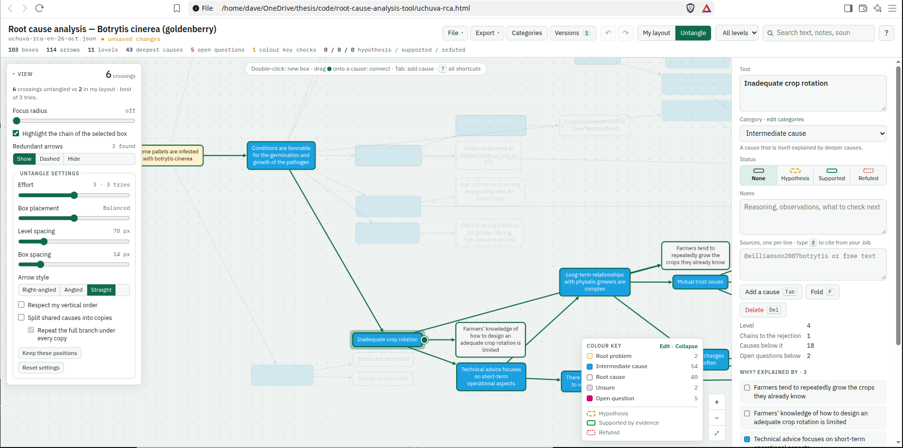

# Uchuva RCA Workbench

An offline editor for the uchuva *Botrytis* root-cause analysis. No install and no internet needed.



Have a look at the video to see how it works briefly. It shows the app in action. Try it yourself: open `uchuva-rca.html` in your browser, then **File → New Empty RCA** and play🚀🚀🚀!!!


## Three modes, one workbench

| File | What it is |
|---|---|
| `index.html` | **Home page**: the three modes in order, with what is open in each |
| `uchuva-rca.html` | **Root causes**: why the problem happens, as a tree of causes |
| `function-analysis.html` | **System** and **Functions**, two modes of one file: the system map with its boundaries, and the function structures that work inside them |

The tools are single offline HTML files with the same look, the same languages, tags, versions and `.bib` citations. They share one code base (see *For developers* at the end). Keep the `.html` files in one folder: the bar above each tool's title switches between modes and leads back to the home page, and `function-analysis.html#system` or `#functions` opens a mode directly. The published viewer on GitHub Pages doesn't show that bar.

## System analysis

The **System** mode of `function-analysis.html` maps what is there before deciding what the system must do, after Fig. 2 of Moreira et al. (2023). It lives in the same file as the function analysis, so functions can point at the elements they act on.

| Element | How it shows |
|---|---|
| Level | Nested rings, outermost first (by default landscape, farm, field, pathogen). Rings show **scale**. Edit them with **Levels** |
| Element | A circle in a ring; the ring is its level. Double-click to add one, drag it into another ring to change its level |
| On several levels | One element, one circle per level: water in the landscape and on the plant. The circles carry numerals I, II… from the outermost level, and selecting one makes the others glow. The name, kind, needs, notes and sources are shared; each circle has its own group, tags (its stage) and boundaries, and a function acts on one circle. **Also on** in the side panel adds a level; **Split** turns a circle into an element of its own |
| Merge | Shift-click elements that are the same thing and pick which name to keep: they become one element with all their circles. The side panel also lists elements that share a name in any language (Roads and Carreteras), with **Review** to merge them or **Keep apart** to stop the suggestion |
| Kind | Actor (thick outline; has a **needs** field, RIO step C), organism, object, condition. Fill colour shows the kind |
| Group | A dotted outline around elements, such as a pathogen's sexual reproduction. Shift-click several, then **G** |
| Stage | An element's tag. With **Draw the stages as a chain** on, the tags of one group appear in order under the rings; ↑ ↓ in the side panel reorder them (the tag editor follows) and clicking a stage highlights its elements |
| Boundary | A named set of elements. Click one in the side panel: the rest fades and a dashed outline goes around its members. **Edit members**, then click elements, a group or a level name to include or exclude them |

Elements keep their level and their place in the ring when you rename, reorder or add levels; deleting a level moves its elements one level in. **Export** gives the map as SVG or PNG (with the boundary in focus, the chain and a key to the kinds) and an elements table with one row per circle (an element on two levels gives two rows with the same id), one column per boundary, the needs, and the functions acting on each circle. Files made before circles existed open with one circle per element, keeping their boundaries and links.

## Function analysis

Open `function-analysis.html`. The first visit shows a small worked example behind the **New function analysis** dialog; cancel to explore it, or fill in the dialog to start your own. The dialog asks for the **overall function** (verb + noun) and the **system boundary** before anything else, because that is where the method starts.

**What you see.** Boxes are functions, arrows are flows. The dashed box is the overall function and the system boundary; boxes outside it are externals (grower, importer, environment). A function you decompose becomes a container holding its subfunctions, so opening a box is literally opening it.

| Element | How it shows |
|---|---|
| Level | Box colour, from dark (level 1) to light. The level comes from the decomposition: change a box's parent under **Part of** in the side panel |
| Auxiliary function | Double border. Toggle with **A** or **Kind** in the side panel |
| Flow type | Colour **and** line pattern: material solid blue, energy dashed orange, signal dotted purple. Readable in black and white. Edit or add types with **Flow types**: colour, pattern (solid, dashed, dotted, dash-dot), line width, and the spacing between dashes or dots |
| Unwanted flow | Red with a hollow arrowhead (inoculum, waste, losses), keeping its type's pattern |
| Tags | Emojis in the box corner, as in the RCA. Functions and flows can both carry tags |

**Variants.** One file holds one catalogue of functions and several variants. A variant is one function structure: its own boundary, decomposition, positions, externals and flows. A function's text, notes, sources, tags and RCA links are shared, so writing a note once reaches every variant. **Variants** duplicates a variant or starts one with another overall function (a moved boundary). Removing a function from a variant keeps it in the catalogue; the side panel lists catalogue functions not in the open variant, ready to place.

**Levels.** The toolbar's level menu, or keys **0**–**9**, closes every box below that level. **0** is the black box: the boundary with only the flows that cross it. Flows into a closed box attach to it; flows that stay inside it disappear.

**The method.** With nothing selected, the side panel shows the variant's boundary (where it starts and ends, what is inside and outside) and six steps: set the boundary, describe the black box, decompose, check the wording, add auxiliary functions, make variants. Steps tick themselves when the diagram shows they are done and list what to look at (a function with no flow in, a flow that never enters the system). You can also tick a step yourself.

**Wording check.** A function should start with a verb that more than one solution could fulfil. The tool checks the first word against the terms of the functional basis of Hirtz et al. (2002), their synonyms (mostly the paper's *correspondents*, e.g. *dampen*, *attenuate* and *minimise* for **decrement**), and everyday postharvest and systems-analysis verbs (keep, dry, cool, sort, monitor, inform…). As you type, it suggests verbs and shows the basis term each synonym belongs to. English forms like *keeps*, *dried* or *removing* count. The Spanish list is a working translation. **Accept verb** adds your own.

**The system map.** With nothing selected, pick the variant's boundary from the system map. Then:

- **Acts on** on each function lists the elements it works on, as Moreira et al. (2023) mark key functions on the pathogen's life cycle. A chip turns amber when the element is outside the boundary.
- An external can be an element of the map; its name then follows the element. **Add externals from the system map** lists the elements outside the boundary.
- A flow can name the element that flows (fruit, conidia, cold air); it is the flow's label when the flow has none.
- **★ Key function** (or **K**) marks the functions critical to the design goals (RIO step F).
- **Against the system map** lists three gaps: elements inside the boundary that no function acts on (with **+ function** to add one), functions acting on something outside the boundary, and externals that are in fact inside. When you switch the variant to another boundary, it also lists which elements came in and which went out.

**Link to the RCA.** **File → Link an RCA file…** reads your RCA file once: its boxes become choices under **Root causes it addresses** on each function, and its stage tags can come along, so functions and causes share the same stages. The link is stored by box id.

| Action | How |
|---|---|
| Add a function | Double-click inside the boundary or inside an open box. **Tab** adds a subfunction to the selected box |
| Add an external | Double-click outside the boundary |
| Draw a flow | Drag the green dot onto another box. Drop inside a box to create a subfunction there; outside the boundary to create an external. **New flows** in the toolbar sets the type |
| Edit text | Double-click a box or a flow, or **Enter**. **Shift+Enter** starts a new line, in boxes and in flow labels |
| Rewire, reverse, delete | As in the RCA: drag a flow's round ends onto another box, **R**, **Del** |
| Bend a flow | Click it and drag the dot in its middle. The side panel switches between Auto, Straight, Curved, Angled (one corner) and Elbow (right angles), with **back to automatic**. A bend is stored relative to the two boxes, so it follows when they move |
| Where a flow attaches | Drag a round end along its own box: it snaps to the outline, and to the middle of a side when close |
| Move a flow's label | Drag the ✥ tab on the label's corner. Two flows between the same boxes stack their labels on their own |
| Box width | Click a box and drag the small square on its bottom-right corner: the text wraps to the new width. Double-click the square, or **automatic width** in the panel, to undo it. Widths and flow shapes belong to the variant |
| Auto-arrange | **View → Auto-arrange left to right** (ELK layered layout, keeps boxes in their containers). It puts hand-shaped flows back to automatic; Ctrl Z undoes it |

**Exports:** SVG and PNG of the open variant; the whole file as JSON; a functions table (the catalogue, with level and parent in the open variant, variants used, key flag, the elements each acts on, RCA causes, verb check); a flows table (type, label, whether it crosses the boundary); and a **morphological chart starter**: one row per function, with empty columns for the means.

## Online viewer (GitHub Pages)

The `docs/` folder is a ready-made website. Once GitHub Pages is on, anyone can open the diagram in a browser, read-only. They can zoom, search, highlight a stage with the tag row, focus on one branch and switch language, but they can't edit.

**Turn it on once:** on GitHub open **Settings → Pages**. Under **Build and deployment**, choose **Deploy from a branch**, branch `main`, folder `/docs`, and save. After a minute the site is at `https://<your-user>.github.io/root-cause-analysis-tool/`.

**Update what visitors see:** in the app choose **File → Publish copy…**, then **Download rca.json**. Replace `docs/rca.json` with it, then commit and push.

The public copy leaves out your notes and the version history unless you tick them, so check the boxes before you publish. Everything in `docs/rca.json` is public.

**Links visitors and you can use:**

| Link | Opens |
|---|---|
| `…/root-cause-analysis-tool/` | The published diagram |
| `…/?box=n7&radius=2` | Focused on one box and its neighbours; viewers get this from **Copy a link to this box** |
| `…/?lang=en` or `?lang=es` | In that language |
| `…/?mode=untangle` | Untangled instead of as drawn |
| `…/?tags=t-harvest,t-sorting` | With those stages highlighted |
| `…/?edit` | The full editor, for anyone to draw their own RCA. Their work stays in their own browser and files; nothing is stored on a server |
| `…/#d=…` | A diagram carried entirely inside the link (see Share links) |

The viewer remembers each visitor's language and emoji choice for their next visit.

**Share links without publishing:** in **File → Publish copy…**, enter your site address once, then **Copy share link**. The whole diagram travels inside the link (about 9,000 characters for the uchuva RCA), so nothing has to be pushed first. Browsers, WhatsApp, Slack and Teams handle links that long; some email programs cut them, so send the GitHub Pages address there.

## Start

1. Double-click `uchuva-rca.html`. It opens in your browser.
2. **File → Open** (Ctrl O) and choose `uchuva-rca.json`.
3. Edit, then **Ctrl S** to save.

Keep both files together, for example in your thesis repo. The `.json` is the RCA itself, with its version history inside. The `.html` is only the tool, so you can copy it anywhere.

## Saving, by browser

| Browser | Ctrl S |
|---|---|
| Chrome, Edge | Writes straight into the file you opened. After the first Ctrl S, every later change is written to the file automatically; the header shows the time of the last save. |
| Firefox, Zen, Brave | Downloads a fresh `uchuva-rca.json`. Move it over the old one. |

Brave disables direct saving by default. If you want it there too, turn on `brave://flags/#file-system-access-api`.

Every change is also kept in the browser between sessions, so closing the tab does not lose work. It is still not a backup: save the file.

## Arrows

An arrow runs from an effect to the cause that explains it. Each step to the right answers "why?".

## Shortcuts

| Action | How |
|---|---|
| New box | Double-click empty space |
| Add a cause to the selected box | Tab |
| Edit text | Double-click the box, or Enter |
| Connect | Hover a box and drag the green dot onto its cause. Drop on empty space to create the cause there. |
| Rewire | Click an arrow, then drag one of its round ends to another box |
| Reverse the selected arrow | R |
| Delete | Del or Backspace. The rest of the chain stays as it is. |
| Select several | Shift-click |
| Fold a branch | F |
| Undo / redo | Ctrl Z / Ctrl Shift Z (or Ctrl Y) |
| Switch layout | L |
| Search | Ctrl F, then Enter to jump between matches |
| All shortcuts | ? |

## Interviews: grading boxes

**Grade** (next to **Edit**) is the mode for interviews over a shared screen. The diagram locks; you can only grade boxes, write why, mark branches as discussed and add causes the interviewee proposes. **Edit** is one click away and keeps every grade. Every click is saved in the browser at once, and if the browser closes mid-call, reopening it resumes the interview.

**Before the first interview,** check **File → Grading scales…**. A scale is a whole-number range (1–3, 0–5…) with a meaning for its lowest and highest value, in each language. A scale can be asked only when another is high enough, for example *Feasibility only when Relevance is at least 3*. The defaults are Relevance 0–5 and Feasibility 1–5, asked from Relevance 3.

**During the call:**

1. Click **Grade**, enter a code for the person (a pseudonym such as `EXP-03`, not a name), their role and the interview language. A version of the diagram is saved first, so you can later see exactly what they were shown.
2. Click a box. Grade it with the big buttons, or with the keyboard: number keys for the first scale, **Shift** + number for the second, **Alt** + number for a third. **N** / **P** move to the next or previous box, top to bottom.
3. **Why** is optional; leave it empty when time is short. The recording covers the rest.
4. Tick **Branches discussed** (in the bar at the top) for the branches you walked through, or press **B** on a box. An ungraded box in a discussed branch counts as *not relevant*; one in a branch you never reached counts as *not discussed*.
5. **A** (or **＋ Add a cause here**) adds a cause under the selected box, marked as proposed by this interviewee.
6. The clock in the bar times each grade. **↺** restarts it from zero, for when the grading starts late.
7. **Shade by Relevance** tints graded boxes by their first-scale value. It's off by default; turn it on if you want the person to see the pattern build up.

**After the call:** **End interview** → add an optional memo → **Save interview file**. That file holds the diagram as it was plus this interview's grades, notes and times, one file per interviewee. **Finish** then clears the grades from your working file, so the next interview starts clean. Boxes added during the interview stay, marked with who proposed them.

**For analysis:** **File → Combine interview files…** reads any number of interview files and writes one CSV: one row per interview × box, with the box text in each language, branch, level, and for each scale the value, its state and the minute it was given. The states are:

| State | Meaning |
|---|---|
| `graded` | Given a value |
| `not graded (branch discussed)` | The branch was discussed but the box wasn't graded. Count it as relevance 0 |
| `not discussed` | The interview never reached that branch. This is missing data, not a zero |
| `gated out` | The condition wasn't met, for example feasibility when relevance was low |
| `not in diagram` | The box didn't exist yet when this interview started |

**Export → Interview grades** does the same for the file that's open.

Interview data never goes into **Publish copy**.

## Branches

The branch picker in the toolbar splits the tree into its main branches, and lists the sub-branches of large ones. **Show only this branch** on any box narrows the view further, and the bar at the top steps back up a level or shows everything.

A box belongs to a branch when every chain from the top problem to it passes through that branch's first box (the *dominator tree*). A cause shared by two branches therefore belongs to the box where they meet, and is marked *shared*. Viewers get the same picker, and links can open on a branch with `?branch=<box id>`.

## Languages

One file keeps every language. When you make a new RCA (**File → New RCA…**) you choose the main language, the one you write in, and any others you'll share it in. For an existing file, use **File → Languages and title…**.

- **Typing a box:** the editor asks for the main language first. Enter moves on to the next language, and Shift Tab goes back.
- **Switching:** the **EN / ES** switch in the toolbar changes the language of the whole diagram. Boxes are sized for their longest language, so the layout doesn't move.
- **Missing translations:** these are counted in the header and listed in the side panel. Those boxes show their text in another language, in italics. **Translate one by one** walks through them: it shows the original text, and Enter saves and moves on to the next box.
- **Category and tag names** have one field per language in their editors, and the title has one in **Languages and title**. Notes stay in one language; they're for you.
- **Make main** switches the main language without losing any text. **The main text is written in…** fixes a file whose language was detected wrongly.
- **Exports:** SVG, PNG and draw.io come out in the language on screen. The CSV and GraphML files have one text column per language.

`uchuva-rca.json` is now a single bilingual file. English is the main language and Spanish the translation, merged from the English file of 26 Oct and the Spanish file of 4 Nov in `outputs/`. The 15 boxes added after 26 Oct still need English. The dated per-language files in `outputs/` are no longer needed for editing.

## Tags

Tags say **where in the chain** a cause happens; colours keep saying what role it plays. A box can carry several tags. They show as emojis in the box's top-left corner, at most three, then "+2". Pick a box's tags in the side panel; with several boxes selected, one click tags them all.

The tag row above the diagram highlights every box with a tag. **Hide emojis on boxes** removes the emojis from the diagram while the tag row keeps working. Click several to see any of them, or search `#harvest`. Use **Tags** in the toolbar to rename tags, pick emojis, add tags and reorder them. Keep the product-flow tags in chain order: that order is used everywhere.

A new RCA starts without tags. The tag editor offers a fresh-produce export chain as an example set, but only if you ask for it. The uchuva file has two groups:

| Group | Tags, in chain order |
|---|---|
| Product flow | 🌱 Culture care · 🧺 Harvest · 🌬️ Calyx drying · 🔍 Sorting · 📦 Packing · ❄️ Storage · 🚚 Inland transport · 🛃 Port & inspection · 🚢 Sea freight |
| Information flow | 📈 Monitoring (measuring °C, RH and rainfall, and using the data for modelling and decisions) · 💬 Communication (sharing information and events along the chain) |

## Categories (colour key)

The starting key:

| Colour | Category | Meaning |
|---|---|---|
| Yellow | Root problem | The problem being explained |
| Blue | Intermediate cause | A cause that has deeper causes below it |
| Grey | Root cause | The deepest causal point you could determine |
| Purple | Unsure | A cause you're not sure about; shades show the degree of doubt |
| Magenta | Open question | A gap in the chain still to investigate |

To change the key, use the **Categories** button, the Category dropdown on a box (**＋ New category…** or **Edit, delete or recolour categories…**), or **Edit** in the colour key on the canvas. In the editor you can:

- Add a category, name it, and pick its fill, outline and text colours.
- Give it a meaning. It shows when you hover over it in the colour key.
- Add lighter or darker shades, and reorder categories.
- Delete a category. If boxes still use it, you choose which category they move to. Ctrl Z undoes the whole change.

A category can also follow a rule. An *intermediate cause* should have deeper causes below it, and a *root cause* should end its chain. Boxes that break their rule appear under **Colour key checks** in the side panel.

## Citing from your .bib

Choose **File → Load bibliography…** and pick the `.bib` file you use for the thesis. The app keeps a copy in the browser, so you only do this once. After you change the `.bib`, load it again.

Type `@` in a box's Sources field to get suggestions:

- Each suggestion shows the key, the first author, the year and the title, so you can tell similar entries apart.
- The search covers the key, author surnames, year, title and journal. Type one word, no spaces, for example `@kan` or `@2019`.
- Use the arrow keys, then Enter or Tab, to insert `@key`, the same form a Typst citation uses.
- Under the field, every `@key` shows its full reference, or a warning if it isn't in your `.bib`.

## Untangle mode

This mode uses the Eclipse Layout Kernel's layered (Sugiyama) algorithm. The View panel shows the live crossing count and compares it with your own layout.

| Setting | What it does |
|---|---|
| Effort | Spends more effort minimising crossings, and at the higher settings keeps the best of up to 10 attempts. |
| Box placement | Compact, Balanced or Straight arrows. |
| Level and box spacing | Distance between columns, and between boxes in a column. |
| Arrow style | Right-angled, angled or straight. |
| Respect my vertical order | Keeps the order you gave the boxes in My layout. |
| Split shared causes | Draws a copy of a box under each box it explains, which removes the crossings shared causes create. A Roman numeral on each copy says how many times the box appears. "Repeat the full branch" also copies everything below it. |
| Keep these positions | Copies the untangled arrangement into My layout. |

These work in both layouts:

| Setting | What it does |
|---|---|
| Focus radius | Shows only boxes within 1 to 6 steps of the selected box. |
| Redundant arrows | Finds arrows already implied by a longer chain (transitive reduction), then shows, dashes or hides them. |

## Exports

| Format | Use |
|---|---|
| SVG | Vector picture for Typst: `#image("uchuva-rca.svg")` |
| PNG | Picture at 2× resolution |
| draw.io | In the language on screen. Round-trips notes, sources, status and tags |
| GraphML | networkx, Gephi or yEd; one text field per language |
| CSV | A table of boxes (one text column per language, plus tags) and a table of arrows |
| Publish copy | `rca.json` for the GitHub Pages site, or a share link |

The SVG and PNG show what is on screen, including the layout mode, folds and filters.

## Editing the tool

`source/` holds the code of both tools; see *For developers* below for the layout. To rebuild:

```
cd source
npm install
python3 build.py      # writes index.html, uchuva-rca.html, function-analysis.html and docs/index.html
```

`docs/index.html` is the RCA app with one extra line, `<meta name="rca-publish" content="rca.json">`, which makes it open `rca.json` read-only.

## For developers

```
source/
  build.py            builds the home page and both tools into one offline HTML file each (and docs/ for the RCA viewer)
  src/core/           shared by every tool: helpers, languages, document state with undo and autosave,
                      open/save, versions, tags, .bib citations, menus, the mode switcher, base.css, shared dialogs
  src/home/           the home page
  src/rca/            the root-cause analysis tool
  src/fa/             the function analysis tool; system.js and syspanel.js hold its System mode
  tests/              browser tests for both tools (Playwright, Chromium)
```

Each tool's script is its `config.js`, then the core, then its own files, concatenated in that order. The core calls a few functions each tool defines; they are listed at the top of each core file. The build stops if a name is defined twice at the top level, and checks the syntax with Node.

```
cd source && npm ci && python3 build.py      # build both tools
python3 source/tests/run.py                  # run every browser test (pip install playwright)
python3 source/tests/run.py test_fa          # only the function analysis tests
```
