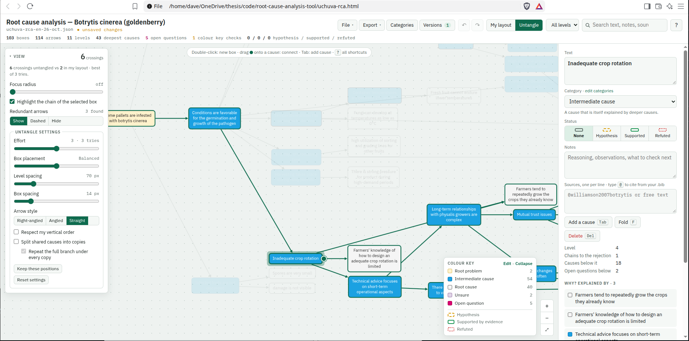

# Uchuva RCA Workbench

An offline editor for the uchuva *Botrytis* root-cause analysis. No install and no internet needed.



Have a look at the video to see how it works briefly. It shows the app in action. Try it yourself: open `uchuva-rca.html` in your browser, then **File → New Empty RCA** and play🚀🚀🚀!!!


## Online viewer (GitHub Pages)

The `docs/` folder is a ready-made website. Once GitHub Pages is on, anyone can open the diagram in a browser, read-only. They can zoom, search, highlight a stage with the tag row, focus on one branch and switch language, but they can't edit.

**Turn it on once:** on GitHub open **Settings → Pages**. Under **Build and deployment**, choose **Deploy from a branch**, branch `main`, folder `/docs`, and save. After a minute the site is at `https://<your-user>.github.io/root-cause-analysis-tool/`.

**Update what visitors see:** in the app choose **File → Publish copy…**, then **Download rca.json**. Replace `docs/rca.json` with it, then commit and push.

The public copy leaves out your notes and the version history unless you tick them, so check the boxes before you publish. Everything in `docs/rca.json` is public.

**Links visitors and you can use:**

| Link | Opens |
|---|---|
| `…/root-cause-analysis-tool/` | The published diagram |
| `…/?box=n7&radius=2` | Focused on one box and its neighbours; viewers get this from **Copy a link to this box** |
| `…/?lang=en` or `?lang=es` | In that language |
| `…/?mode=untangle` | Untangled instead of as drawn |
| `…/?tags=t-harvest,t-sorting` | With those stages highlighted |
| `…/?edit` | The full editor, for anyone to draw their own RCA. Their work stays in their own browser and files; nothing is stored on a server |
| `…/#d=…` | A diagram carried entirely inside the link (see Share links) |

The viewer remembers each visitor's language and emoji choice for their next visit.

**Share links without publishing:** in **File → Publish copy…**, enter your site address once, then **Copy share link**. The whole diagram travels inside the link (about 9,000 characters for the uchuva RCA), so nothing has to be pushed first. Browsers, WhatsApp, Slack and Teams handle links that long; some email programs cut them, so send the GitHub Pages address there.

## Start

1. Double-click `uchuva-rca.html`. It opens in your browser.
2. **File → Open** (Ctrl O) and choose `uchuva-rca.json`.
3. Edit, then **Ctrl S** to save.

Keep both files together, for example in your thesis repo. The `.json` is the RCA itself, with its version history inside. The `.html` is only the tool, so you can copy it anywhere.

## Saving, by browser

| Browser | Ctrl S |
|---|---|
| Chrome, Edge | Writes straight into the file you opened. After the first Ctrl S, every later change is written to the file automatically; the header shows the time of the last save. |
| Firefox, Zen, Brave | Downloads a fresh `uchuva-rca.json`. Move it over the old one. |

Brave disables direct saving by default. If you want it there too, turn on `brave://flags/#file-system-access-api`.

Every change is also kept in the browser between sessions, so closing the tab does not lose work. It is still not a backup: save the file.

## Arrows

An arrow runs from an effect to the cause that explains it. Each step to the right answers "why?".

## Shortcuts

| Action | How |
|---|---|
| New box | Double-click empty space |
| Add a cause to the selected box | Tab |
| Edit text | Double-click the box, or Enter |
| Connect | Hover a box and drag the green dot onto its cause. Drop on empty space to create the cause there. |
| Rewire | Click an arrow, then drag one of its round ends to another box |
| Reverse the selected arrow | R |
| Delete | Del or Backspace. The rest of the chain stays as it is. |
| Select several | Shift-click |
| Fold a branch | F |
| Undo / redo | Ctrl Z / Ctrl Shift Z (or Ctrl Y) |
| Switch layout | L |
| Search | Ctrl F, then Enter to jump between matches |
| All shortcuts | ? |

## Interviews: grading boxes

**Grade** (next to **Edit**) is the mode for interviews over a shared screen. The diagram locks; you can only grade boxes, write why, mark branches as discussed and add causes the interviewee proposes. **Edit** is one click away and keeps every grade. Every click is saved in the browser at once, and if the browser closes mid-call, reopening it resumes the interview.

**Before the first interview,** check **File → Grading scales…**. A scale is a whole-number range (1–3, 0–5…) with a meaning for its lowest and highest value, in each language. A scale can be asked only when another is high enough, for example *Feasibility only when Relevance is at least 3*. The defaults are Relevance 0–5 and Feasibility 1–5, asked from Relevance 3.

**During the call:**

1. Click **Grade**, enter a code for the person (a pseudonym such as `EXP-03`, not a name), their role and the interview language. A version of the diagram is saved first, so you can later see exactly what they were shown.
2. Click a box. Grade it with the big buttons, or with the keyboard: number keys for the first scale, **Shift** + number for the second, **Alt** + number for a third. **N** / **P** move to the next or previous box, top to bottom.
3. **Why** is optional; leave it empty when time is short. The recording covers the rest.
4. Tick **Branches discussed** (in the bar at the top) for the branches you walked through, or press **B** on a box. An ungraded box in a discussed branch counts as *not relevant*; one in a branch you never reached counts as *not discussed*.
5. **A** (or **＋ Add a cause here**) adds a cause under the selected box, marked as proposed by this interviewee.
6. The clock in the bar times each grade. **↺** restarts it from zero, for when the grading starts late.
7. **Shade by Relevance** tints graded boxes by their first-scale value. It's off by default; turn it on if you want the person to see the pattern build up.

**After the call:** **End interview** → add an optional memo → **Save interview file**. That file holds the diagram as it was plus this interview's grades, notes and times, one file per interviewee. **Finish** then clears the grades from your working file, so the next interview starts clean. Boxes added during the interview stay, marked with who proposed them.

**For analysis:** **File → Combine interview files…** reads any number of interview files and writes one CSV: one row per interview × box, with the box text in each language, branch, level, and for each scale the value, its state and the minute it was given. The states are:

| State | Meaning |
|---|---|
| `graded` | Given a value |
| `not graded (branch discussed)` | The branch was discussed but the box wasn't graded. Count it as relevance 0 |
| `not discussed` | The interview never reached that branch. This is missing data, not a zero |
| `gated out` | The condition wasn't met, for example feasibility when relevance was low |
| `not in diagram` | The box didn't exist yet when this interview started |

**Export → Interview grades** does the same for the file that's open.

Interview data never goes into **Publish copy**.

## Branches

The branch picker in the toolbar splits the tree into its main branches, and lists the sub-branches of large ones. **Show only this branch** on any box narrows the view further, and the bar at the top steps back up a level or shows everything.

A box belongs to a branch when every chain from the top problem to it passes through that branch's first box (the *dominator tree*). A cause shared by two branches therefore belongs to the box where they meet, and is marked *shared*. Viewers get the same picker, and links can open on a branch with `?branch=<box id>`.

## Languages

One file keeps every language. When you make a new RCA (**File → New RCA…**) you choose the main language, the one you write in, and any others you'll share it in. For an existing file, use **File → Languages and title…**.

- **Typing a box:** the editor asks for the main language first. Enter moves on to the next language, and Shift Tab goes back.
- **Switching:** the **EN / ES** switch in the toolbar changes the language of the whole diagram. Boxes are sized for their longest language, so the layout doesn't move.
- **Missing translations:** these are counted in the header and listed in the side panel. Those boxes show their text in another language, in italics. **Translate one by one** walks through them: it shows the original text, and Enter saves and moves on to the next box.
- **Category and tag names** have one field per language in their editors, and the title has one in **Languages and title**. Notes stay in one language; they're for you.
- **Make main** switches the main language without losing any text. **The main text is written in…** fixes a file whose language was detected wrongly.
- **Exports:** SVG, PNG and draw.io come out in the language on screen. The CSV and GraphML files have one text column per language.

`uchuva-rca.json` is now a single bilingual file. English is the main language and Spanish the translation, merged from the English file of 26 Oct and the Spanish file of 4 Nov in `outputs/`. The 15 boxes added after 26 Oct still need English. The dated per-language files in `outputs/` are no longer needed for editing.

## Tags

Tags say **where in the chain** a cause happens; colours keep saying what role it plays. A box can carry several tags. They show as emojis in the box's top-left corner, at most three, then "+2". Pick a box's tags in the side panel; with several boxes selected, one click tags them all.

The tag row above the diagram highlights every box with a tag. **Hide emojis on boxes** removes the emojis from the diagram while the tag row keeps working. Click several to see any of them, or search `#harvest`. Use **Tags** in the toolbar to rename tags, pick emojis, add tags and reorder them. Keep the product-flow tags in chain order: that order is used everywhere.

A new RCA starts without tags. The tag editor offers a fresh-produce export chain as an example set, but only if you ask for it. The uchuva file has two groups:

| Group | Tags, in chain order |
|---|---|
| Product flow | 🌱 Culture care · 🧺 Harvest · 🌬️ Calyx drying · 🔍 Sorting · 📦 Packing · ❄️ Storage · 🚚 Inland transport · 🛃 Port & inspection · 🚢 Sea freight |
| Information flow | 📈 Monitoring (measuring °C, RH and rainfall, and using the data for modelling and decisions) · 💬 Communication (sharing information and events along the chain) |

## Categories (colour key)

The starting key:

| Colour | Category | Meaning |
|---|---|---|
| Yellow | Root problem | The problem being explained |
| Blue | Intermediate cause | A cause that has deeper causes below it |
| Grey | Root cause | The deepest causal point you could determine |
| Purple | Unsure | A cause you're not sure about; shades show the degree of doubt |
| Magenta | Open question | A gap in the chain still to investigate |

To change the key, use the **Categories** button, the Category dropdown on a box (**＋ New category…** or **Edit, delete or recolour categories…**), or **Edit** in the colour key on the canvas. In the editor you can:

- Add a category, name it, and pick its fill, outline and text colours.
- Give it a meaning. It shows when you hover over it in the colour key.
- Add lighter or darker shades, and reorder categories.
- Delete a category. If boxes still use it, you choose which category they move to. Ctrl Z undoes the whole change.

A category can also follow a rule. An *intermediate cause* should have deeper causes below it, and a *root cause* should end its chain. Boxes that break their rule appear under **Colour key checks** in the side panel.

## Citing from your .bib

Choose **File → Load bibliography…** and pick the `.bib` file you use for the thesis. The app keeps a copy in the browser, so you only do this once. After you change the `.bib`, load it again.

Type `@` in a box's Sources field to get suggestions:

- Each suggestion shows the key, the first author, the year and the title, so you can tell similar entries apart.
- The search covers the key, author surnames, year, title and journal. Type one word, no spaces, for example `@kan` or `@2019`.
- Use the arrow keys, then Enter or Tab, to insert `@key`, the same form a Typst citation uses.
- Under the field, every `@key` shows its full reference, or a warning if it isn't in your `.bib`.

## Untangle mode

This mode uses the Eclipse Layout Kernel's layered (Sugiyama) algorithm. The View panel shows the live crossing count and compares it with your own layout.

| Setting | What it does |
|---|---|
| Effort | Spends more effort minimising crossings, and at the higher settings keeps the best of up to 10 attempts. |
| Box placement | Compact, Balanced or Straight arrows. |
| Level and box spacing | Distance between columns, and between boxes in a column. |
| Arrow style | Right-angled, angled or straight. |
| Respect my vertical order | Keeps the order you gave the boxes in My layout. |
| Split shared causes | Draws a copy of a box under each box it explains, which removes the crossings shared causes create. A Roman numeral on each copy says how many times the box appears. "Repeat the full branch" also copies everything below it. |
| Keep these positions | Copies the untangled arrangement into My layout. |

These work in both layouts:

| Setting | What it does |
|---|---|
| Focus radius | Shows only boxes within 1 to 6 steps of the selected box. |
| Redundant arrows | Finds arrows already implied by a longer chain (transitive reduction), then shows, dashes or hides them. |

## Exports

| Format | Use |
|---|---|
| SVG | Vector picture for Typst: `#image("uchuva-rca.svg")` |
| PNG | Picture at 2× resolution |
| draw.io | In the language on screen. Round-trips notes, sources, status and tags |
| GraphML | networkx, Gephi or yEd; one text field per language |
| CSV | A table of boxes (one text column per language, plus tags) and a table of arrows |
| Publish copy | `rca.json` for the GitHub Pages site, or a share link |

The SVG and PNG show what is on screen, including the layout mode, folds and filters.

## Editing the tool

`source/` holds the app code: `src/app.js`, `src/app.css` and `src/app.html`. To rebuild the single file:

```
cd source
npm install
python3 build.py      # writes uchuva-rca.html and docs/index.html
```

`docs/index.html` is the same app with one extra line, `<meta name="rca-publish" content="rca.json">`, which makes it open `rca.json` read-only.
